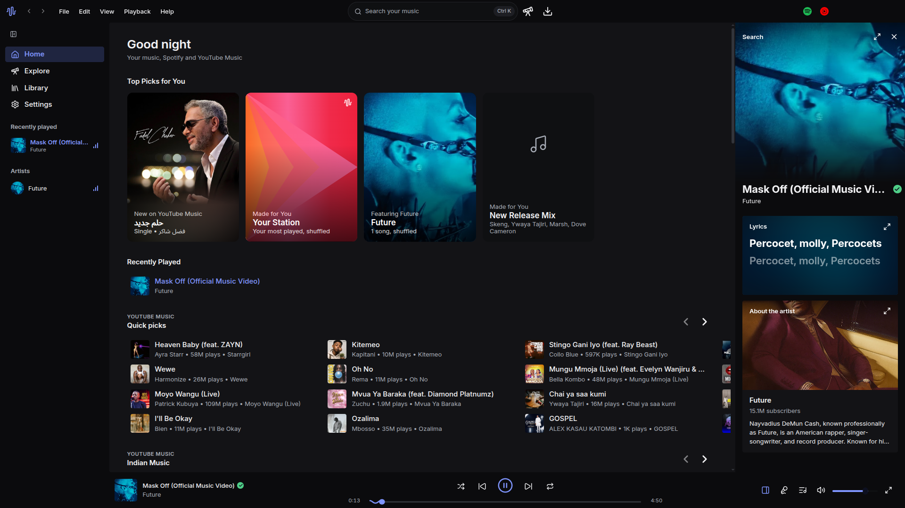

<div align="center">


# wavebit

Your music files, your Spotify library and YouTube Music in one desktop player.

[](https://github.com/Wavebit-app/wavebit/releases/latest)
[](https://github.com/Wavebit-app/wavebit/actions/workflows/release.yml)
[](LICENSE)



</div>

- Plays your own files, with crossfade and volume levelling
- Shows your Spotify library, matched against the songs you have
- Streams YouTube Music
- Downloads songs, whole albums and playlists, with covers and lyrics
- Synced lyrics, full-screen player and artwork themes
- Updates itself and shows you what's new

## Download

| Windows                                                                    | macOS (Apple Silicon)                                                       | Linux                                                                            |
| -------------------------------------------------------------------------- | --------------------------------------------------------------------------- | -------------------------------------------------------------------------------- |
| [Installer (.exe)](https://github.com/Wavebit-app/wavebit/releases/latest) | [Disk image (.dmg)](https://github.com/Wavebit-app/wavebit/releases/latest) | [AppImage · .deb · .rpm](https://github.com/Wavebit-app/wavebit/releases/latest) |

Builds aren't code-signed yet, so Windows and macOS will warn you the first time.

## Build it yourself

```sh
git clone https://github.com/Wavebit-app/wavebit.git && cd wavebit
npm install
npm start        # needs Node and Rust. npm run dist builds installers
```

See [CONTRIBUTING.md](CONTRIBUTING.md) to help out.

MIT licensed. Not affiliated with Spotify or YouTube.
