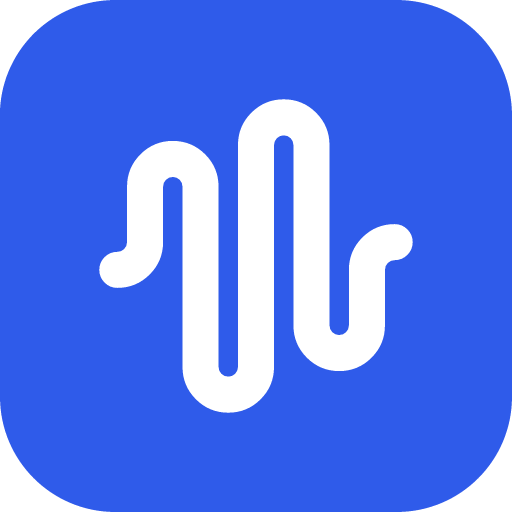
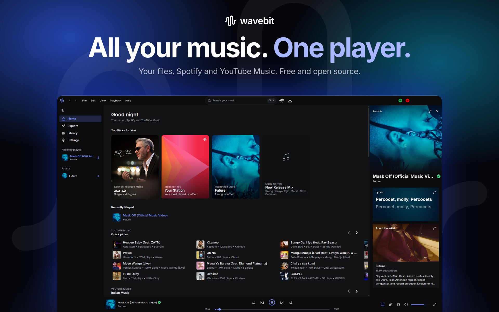

<div align="center">



# wavebit

### All your music in one open-source player

Your files, your Spotify library and YouTube Music, side by side.

<br>

[](https://github.com/Wavebit-app/wavebit/releases/latest)
[](https://github.com/Wavebit-app/wavebit/actions/workflows/release.yml)
[](LICENSE)

[**Features**](#features) · [**Download**](#download) · [**Build it yourself**](#build-it-yourself) · [**Contributing**](#contributing) · [**Disclaimer**](#disclaimer)

<br>



</div>

> [!IMPORTANT]
> wavebit is not affiliated with, endorsed by, or connected to Spotify, YouTube or Google in any way. Use it at your own discretion.

---

<div align="center">

<h1><a id="features"></a>Features</h1>

<table>
  <tr>
    <td width="50%" valign="top">

#### Playback

- **Your own files**, scanned from your music folders and watched for changes.
- **YouTube Music streaming**, with search, Explore, moods and genres.
- **Crossfade** up to 12 seconds.
- **Volume levelling** at Quiet, Normal or Loud.
- **Seven-band equalizer**, playback speed and skip silence.
- **AutoPlay**, and a queue that carries on after a restart.

#### Downloads

- **Save songs, whole albums and playlists** to your library.
- **Covers and lyrics** embedded in each file.
- **Artist and album folders**, up to four songs at a time.
- **Keeps downloaded playlists up to date.**

    </td>
    <td width="50%" valign="top">

#### Accounts and library

- **Spotify library**, with your playlists matched against the songs you own.
- **Spotify Canvas** motion artwork.
- **Sign in to YouTube Music** for your own home, library and playlists.
- **Top Picks**, stations and your listening history.

#### Experience

- **Synced lyrics** from nine sources, including [LRCLIB](https://lrclib.net).
- **Artwork themes** that take their colours from the cover, plus Light, Dark, Black and Midnight.
- **Full-screen player**, system tray controls and keyboard shortcuts.
- **Updates itself** and shows you what's new.

</td>
</tr>
</table>

</div>

---

<div align="center">

<h1><a id="download"></a>Download</h1>

| Windows                                                                    | macOS (Apple Silicon)                                                       | Linux                                                                            |
| -------------------------------------------------------------------------- | --------------------------------------------------------------------------- | -------------------------------------------------------------------------------- |
| [Installer (.exe)](https://github.com/Wavebit-app/wavebit/releases/latest) | [Disk image (.dmg)](https://github.com/Wavebit-app/wavebit/releases/latest) | [AppImage · .deb · .rpm](https://github.com/Wavebit-app/wavebit/releases/latest) |

Builds aren't code-signed yet, so Windows and macOS will warn you the first time.

</div>

---

<div align="center">

<h1><a id="build-it-yourself"></a>Build it yourself</h1>

</div>

```sh
git clone https://github.com/Wavebit-app/wavebit.git && cd wavebit
npm install
npm start        # needs Node and Rust. npm run dist builds installers
```

---

<div align="center">

<h1><a id="contributing"></a>Contributing</h1>

Contributions are welcome. Please read the [Contributing Guide](CONTRIBUTING.md) and [Code of Conduct](CODE_OF_CONDUCT.md) before opening a pull request.

</div>

---

<div align="center">

<h1><a id="disclaimer"></a>Disclaimer & Legal Notice</h1>

wavebit is an independent, community-driven music player. It is **not** associated with Spotify AB, Google LLC, YouTube, or any of their parent companies.

</div>

- **No media hosting:** wavebit does not host, upload or store copyrighted music. It plays files on your own computer and reads from services you sign in to yourself.
- **Your responsibility:** wavebit is made for personal and educational use. You are responsible for following your local copyright laws and the terms of any service you connect. Only download music you have the right to keep.
- **Unofficial access:** wavebit reaches Spotify and YouTube in ways those companies don't officially support. They can change or block this at any time, and using it may break their terms.
- **No warranty:** wavebit is provided as is, without warranty of any kind.
- **Copyleft:** wavebit is free software under the GPLv3. Anyone may sell or redistribute copies, but every distribution must come with the Corresponding Source under the same license.

---

<div align="center">

<h1><a id="license"></a>License</h1>

This project is licensed under the **GNU General Public License v3.0 (GPLv3)**. See the [LICENSE](LICENSE) file for details.

</div>
